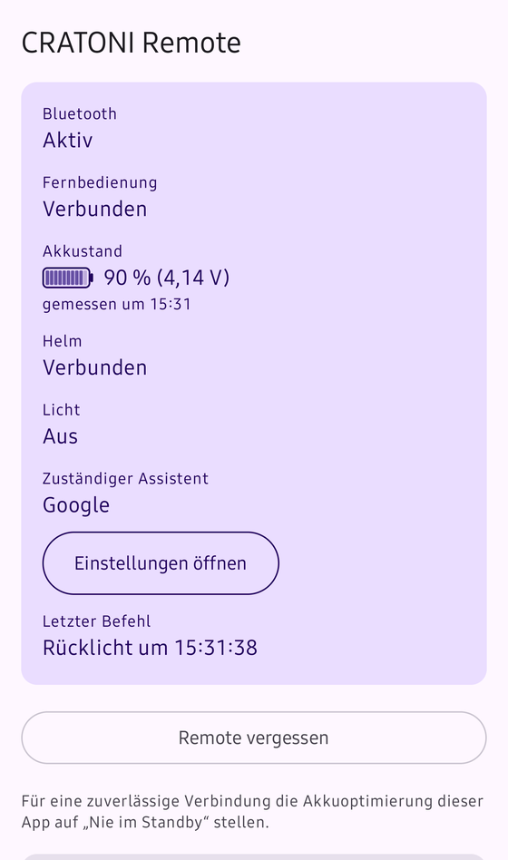
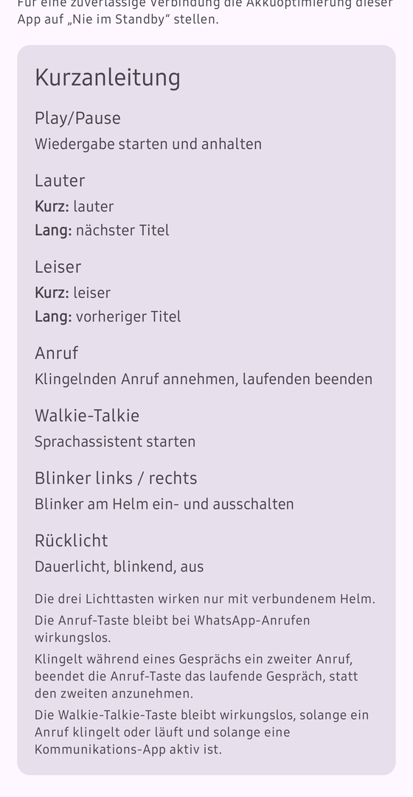
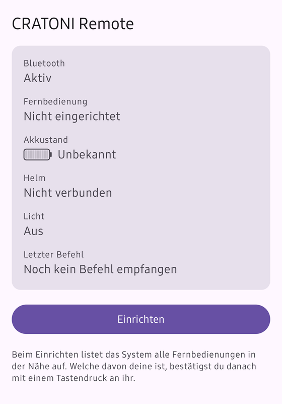
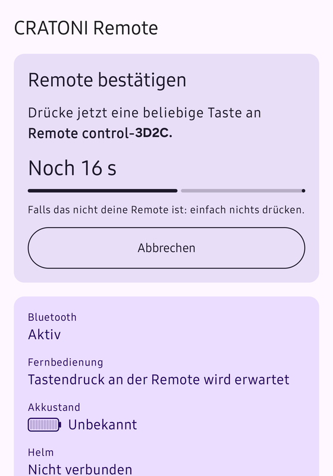

# CRATONI SMARTRIDE 1.2 Remote – Android-App

English version: [README.md](README.md)

> [!WARNING]
> **Keine Sturzerkennung, kein Notruf.** Der Helm bietet zusammen mit der Hersteller-App eine Unfall- bzw. Sturzerkennung, die im Ernstfall eine SMS an hinterlegte Kontakte sendet. **Diese App unterstützt das nicht.** Sie wertet keine Sturzmeldung aus, sendet keine SMS und setzt keinen Notruf ab.
>
> Das ist kein rein theoretischer Unterschied: Die Fernbedienung nimmt nur **eine** Bluetooth-Verbindung auf einmal an. Solange diese App verbunden ist, kann die Hersteller-App die Fernbedienung nicht nutzen. Wer sich auf die Sturzerkennung verlässt, sollte diese App deshalb **nicht** anstelle der Hersteller-App einsetzen.

Eine eigene Android-App für die Bluetooth-LE-Fernbedienung des Fahrradhelms CRATONI SMARTRIDE 1.2. Sie ersetzt die Hersteller-App für den laufenden Betrieb: Die App verbindet sich selbst mit der Fernbedienung und setzt deren Tasten systemweit um, auch bei geschlossener Oberfläche und gesperrtem Bildschirm. Die Tasten steuern Medienwiedergabe, Anrufe, Lautstärke und den Sprachassistenten; zusätzlich schalten sie Blinker und Rücklicht am Helm.

## Haftung und Unabhängigkeit

Dies ist ein privates, unabhängiges Projekt. Es besteht keine Verbindung zum Hersteller des Helms, und der Hersteller hat das Projekt weder beauftragt noch geprüft oder freigegeben. Produkt- und Markennamen dienen ausschließlich dazu, das Gerät zu bezeichnen, mit dem die App zusammenarbeitet; sie gehören ihren jeweiligen Inhabern.

- Die Software wird ohne jede Gewähr bereitgestellt. Die Nutzung erfolgt auf eigenes Risiko.
- **Straßenverkehr:** Die App kann Blinker und Rücklicht am Helm schalten. Die Lichtfunktion ist kein geprüftes Sicherheitssystem. Der Helm bestätigt keinen Schaltvorgang; die App führt den Lichtzustand selbst und kann nicht erkennen, ob ein Befehl angekommen ist oder ob das Licht tatsächlich leuchtet. Wer sich im Straßenverkehr darauf verlässt, tut das auf eigene Verantwortung. Im Zweifel Handzeichen geben und die Beleuchtung am Helm prüfen.
- Die Kommunikation mit Fernbedienung und Helm wurde durch Beobachtung des eigenen Geräts ermittelt (Interoperabilität), nicht aus Herstellerunterlagen. Es wurde keine Firmware verändert. Die App schreibt weder auf den Firmware-Update-Kanal (OTA) der Fernbedienung noch auf deren übrige Schreib-Characteristics. Zum Helm sendet sie ausschließlich die beobachteten Lichtbefehle.
- Während die App mit der Fernbedienung verbunden ist, kann die Hersteller-App sie nicht gleichzeitig nutzen: Die Fernbedienung nimmt nur eine Verbindung auf einmal an.

## Bildschirme

| Verbunden | Kurzanleitung | Nicht eingerichtet | Bestätigung beim Einrichten |
|---|---|---|---|
|  |  |  |  |

Der Gerätename im vierten Bild ist ein Beispiel; er wurde für die Veröffentlichung ersetzt. Das dritte Bild ist älter als die Assistenten-Zeile und zeigt sie deshalb nicht.

Die Screenshots zeigen die deutsche Oberfläche; auf einem Gerät mit englischer Sprache zeigt die App den englischen Wortlaut.

## Funktionsumfang

- Tastenbelegung der Fernbedienung:
  - Play/Pause (als Medientaste an die aktive Medien-App)
  - Die beiden Lautstärketasten sind Doppeltasten. Ein kurzer Druck ändert die Lautstärke; ein langer Druck springt zum nächsten Titel (Taste Lauter) bzw. zum vorherigen Titel (Taste Leiser), als Medientasten an die aktive Medien-App. Was ein kurzer und was ein langer Druck ist, legt die Fernbedienung selbst fest; sie sendet für jeden ein eigenes Paket. Die App erkennt keine Druckdauer und kann diese Belegung nicht ändern.
  - Lauter/Leiser (kurzer Druck): Die Lautstärke richtet sich nach dem Audio-Modus. Im Telefonat bzw. bei Sprachverbindungen wirkt sie auf die Gesprächslautstärke, sonst auf die Medienlautstärke.
  - Anruf-Taste: nimmt einen klingelnden Anruf an bzw. beendet ein laufendes Gespräch
  - Walkie-Talkie-Taste: startet den Sprachassistenten
  - Blinker links und rechts am Helm (ein/aus)
  - Rücklicht am Helm mit drei Zuständen (aus, Dauerlicht, blinkend)
- Anzeige des Akkustands der Fernbedienung (Prozent und Zellenspannung) mit Warnung bei 20 %, 10 % und 0 %.
- Vordergrunddienst, der nur läuft, solange die Fernbedienung in Reichweite ist, mit automatischem Wiederverbinden. Seine dauerhafte Benachrichtigung zeigt Verbindungszustand, Akkustand und letzten Befehl in denselben Worten wie die App, in der Sprache der App.
- Einrichtung über eine Geräteliste, bei der die gewählte Fernbedienung per Tastendruck bestätigt wird.
- Tastenlegende in der App: eine dauerhaft sichtbare Karte am Ende des Hauptbildschirms („Was die Tasten tun“), die diese Belegung im Gerät selbst erklärt, einschließlich kurzem und langem Druck der Lautstärketasten, dazu zwei Fußnoten (die Lichttasten wirken nur mit verbundenem Helm; die Anruf-Taste bleibt bei WhatsApp-Anrufen wirkungslos). Sie bleibt sichtbar, wenn keine Fernbedienung eingerichtet ist, und ist ausgeblendet, solange beim Einrichten eine Bestätigung läuft.
- Sprache: Die App folgt der Systemsprache (siehe Voraussetzungen).

## Voraussetzungen

> [!NOTE]
> **Sprache:** Die App folgt der Systemsprache. Ausgeliefert werden Englisch und Deutsch; jede andere Systemsprache bekommt Englisch. Die Sprache lässt sich außerdem pro App in den Android-Systemeinstellungen umstellen (Einstellungen > Apps > CRATONI Remote > Sprache; der genaue Pfad kann je nach Hersteller abweichen). Die Screenshots in diesem README zeigen weiterhin die deutsche Oberfläche. Die Bezeichnungen der Oberfläche sind in diesem Dokument auf Deutsch angegeben; auf einem Gerät mit englischer Sprache zeigt die App den englischen Wortlaut.

Zur Nutzung:

- **Android 16 (API 36) oder neuer ist zwingend** (`minSdk = 36`). Auf älteren Geräten lässt sich die App nicht installieren.
- **Getestet wurde ausschließlich auf einem Samsung Galaxy S25 Ultra mit Android 16 (One UI 8.5).** Andere Geräte, Hersteller-Oberflächen und Android-Versionen sind ungeprüft.
- Die App enthält keinen eigenen nativen Code (keine C/C++-Quellen, keine NDK-Konfiguration). Eine Einschränkung auf bestimmte Prozessorarchitekturen besteht daher nicht.
- Das Gerät braucht Bluetooth Low Energy und die Companion-Device-Unterstützung (beides im Manifest als erforderlich deklariert).
- Eine Fernbedienung und ein Helm CRATONI SMARTRIDE 1.2.
- Bei Installation außerhalb des Play Store muss die Installation aus unbekannten Quellen für die installierende App erlaubt sein (Android-Einstellungen).
- Ein Update muss mit derselben Signatur erstellt sein wie die installierte Fassung. Andernfalls verweigert Android die Aktualisierung; die installierte App muss dann zuerst deinstalliert werden, wodurch Kopplung und Berechtigungen verloren gehen.

Zum Bauen: Alle Angaben aus `app/build.gradle.kts` und `gradle/libs.versions.toml`, soweit nicht anders vermerkt.

| Bestandteil | Wert | Quelle |
|---|---|---|
| Android auf dem Gerät | Android 16 (API 36) oder neuer | `minSdk = 36` |
| `targetSdk` / `compileSdk` | 36 / 37 | `app/build.gradle.kts` |
| JDK | 17 (Quell- und Zielkompatibilität `VERSION_17`) | `app/build.gradle.kts` |
| Android Gradle Plugin | 9.4.0 | `gradle/libs.versions.toml` |
| Kotlin | 2.4.20 | `gradle/libs.versions.toml` |
| Gradle | 9.7.1 (über den Wrapper) | `gradle/wrapper/gradle-wrapper.properties` |
| Compose BOM | 2026.09.00 | `gradle/libs.versions.toml` |

- Android SDK mit der Plattform 37 (für `compileSdk = 37`). Der Pfad zum SDK steht in der lokalen Datei `local.properties`, die nicht im Repository liegt.

## Bauen und installieren

Fertige Fassung: Unter „Releases“ des GitHub-Repositories liegt eine signierte Fassung (v1.0.0). Alternativ lässt sich die App selbst bauen (siehe unten). Wer selbst baut und signiert, erzeugt eine andere Signatur; eine Fassung aus „Releases“ lässt sich dann nicht darüber aktualisieren und umgekehrt.

Die Fassung v1.0.0 ist älter als drei Funktionen, die in diesem Dokument beschrieben sind: Folgen der Systemsprache (v1.0.0 ist ausschließlich deutsch), die übersetzbare Benachrichtigung und die Tastenlegende. Sie stecken nur in Builds aus dem aktuellen Quelltext.

Zielplattform: Entwicklungsrechner mit JDK 17 und Android SDK; Android 16 auf dem Gerät. Unter Windows (PowerShell) statt `./gradlew` den Aufruf `.\gradlew.bat` verwenden.

Debug-APK bauen:

```bash
./gradlew assembleDebug
```

Release-APK bauen (nur signiert, wenn `keystore.properties` vorhanden ist, siehe Hinweise):

```bash
./gradlew assembleRelease
```

Unit-Tests ausführen:

```bash
./gradlew testDebugUnitTest
```

Lint ausführen:

```bash
./gradlew lintDebug
```

Die Debug-APK liegt danach unter `app/build/outputs/apk/debug/`, die Release-APK unter `app/build/outputs/apk/release/`. Installation auf ein per USB-Debugging verbundenes Gerät:

```bash
adb install -r app/build/outputs/apk/debug/app-debug.apk
```

Auf Geräten mit mehreren Nutzerprofilen (zum Beispiel Secure Folder) gegebenenfalls zusätzlich `--user 0` angeben.

Hinweise:

- Der Debug-Build ist mit dem automatisch erzeugten Debug-Schlüssel signiert. Der Release-Build liest die Signaturdaten aus der Datei `keystore.properties` im Projektstammverzeichnis (Vorlage: `keystore.properties.example`). Fehlt die Datei oder ist sie unvollständig, läuft der Build trotzdem, das Release-Artefakt bleibt aber unsigniert; auf den Debug-Schlüssel fällt er bewusst nicht zurück. Schlüsseldateien (`*.jks`, `*.keystore`) und `keystore.properties` sind in `.gitignore` ausgeschlossen und liegen nicht im Repository. Ohne den Schlüssel und seine Passwörter lässt sich eine veröffentlichte Fassung nicht mehr aktualisieren.
- Der Debug-Build enthält zusätzlich einen Debug-Auslöser für Befehle per `adb`; er ist nur für die Entwicklung gedacht.
- **Deinstallieren entfernt die Kopplung und die erteilten Berechtigungen.** Danach ist eine neue Einrichtung nötig. Ein Update mit `adb install -r` behält beides.

## Einrichtung in der App

Zweck: Die App mit genau einer Fernbedienung verbinden und diese Wahl bestätigen.

Voraussetzungen:

- Der Helm ist in den Android-Bluetooth-Einstellungen gekoppelt. Die App sucht ihn unter den gekoppelten Geräten anhand des Namenspräfixes `SMARTRIDE` und verbindet nur, wenn genau ein solches Gerät gekoppelt ist.
- Bluetooth ist eingeschaltet, die Fernbedienung ist eingeschaltet und in der Nähe.
- Der Standort-Schalter in den Systemeinstellungen ist während der Einrichtung aktiv (Anforderung des Companion-Device-Dialogs). Die App selbst verlangt keine Standortberechtigung.

Schritte:

1. App öffnen und über „Berechtigungen erteilen“ den Bluetooth-Zugriff, Benachrichtigungen und „Anrufe annehmen“ freigeben (siehe Abschnitt Berechtigungen).
2. „Einrichten“ antippen. Das System zeigt eine Liste aller Fernbedienungen in Reichweite (Namen der Form `Remote control-XXXX`).
3. Die eigene Fernbedienung wählen. Mehrere Fernbedienungen tragen dasselbe Namensmuster; die Liste allein erlaubt deshalb keine sichere Zuordnung.
4. Die App zeigt „Remote bestätigen“ mit einem Countdown von 30 Sekunden. In dieser Zeit eine beliebige Taste an der gewählten Fernbedienung drücken.
5. Kommt der Tastendruck über die Verbindung dieser Fernbedienung an, gilt die Wahl als bestätigt, und die Kopplung bleibt bestehen.

**Wird nichts gedrückt** (oder „Abbrechen“ gewählt, oder Bluetooth ausgeschaltet), nimmt die App die Kopplung zurück und meldet es. Einen Tastendruck an einer fremden Fernbedienung bestätigt die Wahl nicht, solange er nicht über die Verbindung der gewählten Fernbedienung ankommt. Bis zur Bestätigung führt die App keine Tastenbefehle aus.

Verifikation: Im Hauptbildschirm zeigt „Fernbedienung“ den Zustand „Verbunden“, „Letzter Befehl“ zeigt den zuletzt gedrückten Befehl, und im Akkufeld erscheint ein Messwert. Nach dem Ausschalten der Fernbedienung beendet sich der Dienst; beim erneuten Einschalten verbindet das System die App von selbst.

Rückgängig machen: „Remote vergessen“ entfernt die Kopplung, beendet den Dienst und löscht die gespeicherte Bestätigung. Danach ist eine neue Einrichtung nötig.

Samsung-Geräte: Die App zeigt den Hinweis, die Akkuoptimierung der App auf „Nie im Standby“ zu stellen. Ob die Companion-Device-Funktion auf One UI vor der Akkuoptimierung schützt, ist nicht belegt.

## Eine Fassung am Gerät prüfen

Zweck: Eine gebaute oder heruntergeladene Fassung vor dem Einsatz auf dem eigenen Gerät durchgehen. Die Punkte stammen aus den Gerätetests, die in `docs/architektur.md` (Abschnitt 11) protokolliert sind. Sie ersetzen keine Prüfung im Straßenverkehr.

Voraussetzungen:

- Zielplattform: Android 16 (API 36) oder neuer; getestet wurde nur auf einem Samsung Galaxy S25 Ultra mit One UI 8.5.
- Eine Fernbedienung und ein Helm, der in den Android-Bluetooth-Einstellungen gekoppelt ist; die Hersteller-App ist beendet (die Fernbedienung nimmt nur eine Verbindung an).
- Eine Medien-App mit laufender Wiedergabe und die Möglichkeit, einen Anruf zu empfangen.
- Die Berechtigungen aus dem Abschnitt Einrichtung sind erteilt, soweit der jeweilige Punkt sie braucht.

**Achtung, vor dem ersten Schritt:** Die Punkte unter „Einrichten“ wurden am Gerät ausgehend von einer nicht eingerichteten App geprüft (frische Installation oder nach „Remote vergessen“). Ist bereits eine Fernbedienung eingerichtet, entfernt „Remote vergessen“ die bestehende Kopplung und die gespeicherte Bestätigung; danach ist eine neue Einrichtung nötig. Das ist ohnehin der erste Prüfpunkt.

Einrichten:

- [ ] Fernbedienung aus der Liste wählen und mit einem Tastendruck bestätigen. Der Bestätigungsdruck löst keine Aktion aus (keine Wiedergabe, kein Licht); danach wirken die Tasten.
- [ ] Neu einrichten und 30 Sekunden lang nichts drücken: Die Kopplung wird zurückgenommen, die App meldet „Es kam kein Tastendruck – die Kopplung wurde zurückgenommen.“
- [ ] Neu einrichten und während des Countdowns zur Startseite des Telefons zurückkehren: Die Frist läuft trotzdem ab, die Kopplung wird zurückgenommen.
- [ ] Neu einrichten und während des Countdowns Bluetooth ausschalten: Der Vorgang endet sofort mit der Bluetooth-Meldung, die Kopplung wird zurückgenommen.

Tasten (bei verbundener Fernbedienung und verbundenem Helm):

- [ ] Play/Pause, nächster Titel, vorheriger Titel steuern die Medien-App.
- [ ] Lauter und Leiser ändern bei Musik die Medienlautstärke.
- [ ] Lauter und Leiser ändern im Telefonat die Gesprächslautstärke (das Lautstärke-Panel zeigt „Gesprächslautstärke“), die Medienlautstärke bleibt unverändert.
- [ ] Anruf-Taste nimmt einen klingelnden Anruf an; ein zweiter Druck kurz danach beendet das Gespräch nicht (Sperre von 3 Sekunden); später beendet ein Druck das Gespräch.
- [ ] Walkie-Talkie-Taste startet den Sprachassistenten, auch bei gesperrtem Bildschirm.
- [ ] Blinker links und Blinker rechts schalten am Helm ein und wieder aus.
- [ ] Rücklicht wechselt bei jedem Druck zwischen den drei Zuständen aus, Dauerlicht und blinkend.

Verbindung und Anzeige:

- [ ] Helm nach der Fernbedienung einschalten: Er verbindet sich von allein, ohne Tastendruck; „Helm“ zeigt „Verbunden“.
- [ ] Helm ausschalten: „Helm“ geht auf „Nicht verbunden“.
- [ ] Der Akkustand erscheint und aktualisiert sich (Abfrage beim Verbinden und danach alle 5 Minuten). Die Warnung bei 20 % ist am Gerät nur mit einem simulierten Wert geprüft; ein echter Test setzt eine entsprechend entladene Fernbedienung voraus.
- [ ] Bluetooth aus- und wieder einschalten: Die Fernbedienung verbindet sich nach wenigen Sekunden selbst wieder.
- [ ] Fernbedienung aus- und wieder einschalten: Der Dienst kommt zurück, ohne dass die App geöffnet wird.
- [ ] Die Zeile „Zuständiger Assistent“ zeigt den Namen der Assistenten-App; der Knopf „Einstellungen öffnen“ öffnet eine Systemseite.

Verifikation: Alle Punkte sind abgehakt, und im Hauptbildschirm zeigt „Fernbedienung“ „Verbunden“. Ein fehlgeschlagener Punkt ist ein Befund; er gehört mit Gerät und Android-Version dokumentiert.

Rückgängig machen: „Remote vergessen“ entfernt die Kopplung und beendet den Dienst; danach ist eine neue Einrichtung nötig.

Bekannte Probleme beim Prüfen: Im Telefonat gehen einzelne Tastendrücke verloren (siehe Abschnitt Bekannte Grenzen); ein fehlender Druck im Telefonat ist daher kein sicheres Zeichen für einen Fehler. WhatsApp-Anrufe lassen sich mit der Anruf-Taste nicht annehmen oder beenden. Die Mehrfachauswahl mit mehreren Fernbedienungen ist nie am Gerät geprüft worden.

## Berechtigungen

Nach `app/src/main/AndroidManifest.xml`:

| Berechtigung | Art | Zweck |
|---|---|---|
| `BLUETOOTH_CONNECT` | Laufzeit | GATT-Verbindung zur Fernbedienung, Verbindung zum Helm; Voraussetzung für den Vordergrunddienst-Typ `connectedDevice` |
| `POST_NOTIFICATIONS` | Laufzeit | Benachrichtigung des Vordergrunddienstes und Akkuwarnung |
| `ANSWER_PHONE_CALLS` | Laufzeit | Anruf-Taste: Anruf annehmen und beenden. Ohne sie bleibt nur diese Taste wirkungslos. |
| `FOREGROUND_SERVICE`, `FOREGROUND_SERVICE_CONNECTED_DEVICE` | normal | Vordergrunddienst für die Verbindung |
| `REQUEST_OBSERVE_COMPANION_DEVICE_PRESENCE` | normal | Das System meldet, wenn die Fernbedienung in Reichweite kommt |
| `REQUEST_COMPANION_START_FOREGROUND_SERVICES_FROM_BACKGROUND` | normal | Start des Vordergrunddienstes aus dem Hintergrund nach einer solchen Meldung |

Bewusst nicht angefordert: Standort, `BLUETOOTH_SCAN` (das System sucht für den Kopplungsdialog, die App scannt nie selbst), `READ_PHONE_STATE`, Zugriff auf Benachrichtigungen (kein NotificationListener), `WAKE_LOCK`, `RECEIVE_BOOT_COMPLETED`.

## Technik

Kurzüberblick; Protokolle, Messungen und Entscheidungen stehen in [`docs/architektur.md`](docs/architektur.md).

- **Fernbedienung:** Bluetooth Low Energy, GATT. Service `0000FFF0-0000-1000-8000-00805F9B34FB`, Tasten als Notifications der Characteristic `0000FFF4-0000-1000-8000-00805F9B34FB` (Pakete mit Header `0x0F` und Prüfsumme). Derselbe Characteristic liefert per Lesezugriff den Akkustatus. Der Parser ist reines Kotlin und per Unit-Test geprüft.
- **Helm:** klassisches Bluetooth (BR/EDR) mit Serial Port Profile über RFCOMM. Der Helm muss in Android gekoppelt sein; die App öffnet zusätzlich eine eigene SPP-Verbindung für die Lichtbefehle, Audio und Freisprechen bleiben unberührt.
- **Kopplung und Hintergrund:** `CompanionDeviceManager` (nicht self-managed, ohne Geräteprofil) übernimmt Kopplung und Präsenzerkennung. `CompanionDeviceService` startet bei Anwesenheit der Fernbedienung den Vordergrunddienst (Typ `connectedDevice`) und beendet ihn bei Abwesenheit.
- **Aktionen:** Medientasten und Assistent über `AudioManager.dispatchMediaKeyEvent`, Lautstärke über `AudioManager.adjustStreamVolume`, Anrufe über `TelecomManager`.
- Ein Gradle-Modul `:app`, Kotlin, Jetpack Compose; keine Bibliotheken für Dependency Injection, Media oder BLE.

## Bekannte Grenzen und offene Punkte

- **Sturzerkennung und Notfall-SMS fehlen** (siehe Warnung oben). Die Unfall- bzw. Sturzerkennung des Helms, die über die Hersteller-App eine SMS an hinterlegte Kontakte auslöst, wird von dieser App nicht unterstützt. Ob und wie der Helm ein Sturzereignis über die hier genutzten Kanäle überhaupt meldet, wurde nie untersucht. Eine spätere Unterstützung ist nicht ausgeschlossen, setzt aber voraus, dass sich das Ereignis zuverlässig erkennen lässt — eine Notruffunktion, die im Ernstfall nicht auslöst, wäre schlimmer als keine.
- **WhatsApp-Anrufe:** Die Anruf-Taste reagiert nicht. WhatsApp setzt den Audio-Modus schon beim Klingeln auf Kommunikation; die App erkennt darin einen laufenden Anruf, kann ihn aber nicht beenden und tut deshalb nichts. Die Lautstärketasten wirken im Gespräch dagegen.
- **Anklopfen:** Klingelt während eines Gesprächs ein zweiter Anruf, beendet die Anruf-Taste das laufende Gespräch, statt den zweiten anzunehmen.
- **Verlorene Tastenpakete bei Telefonaten:** Während eines Telefonats kommen einzelne Tastendrücke nicht an. Die betreffenden Pakete wurden nie empfangen. Vermutet wird eine Funk-Koexistenz zwischen Sprachverbindung und BLE-Verbindung; die Ursache ist nicht belegt und die Verlustrate nicht gemessen.
- **Mehrere Fernbedienungen:** Die Auswahl aus einer Liste mit Bestätigung per Tastendruck wurde nie mit einer echten zweiten Fernbedienung geprüft.
- **Strenges Namensmuster:** Die Fernbedienung wird nur gefunden, wenn ihr beworbener Name exakt `Remote control-` plus vier Hexadezimalziffern lautet (Muster `^Remote control-[0-9A-Fa-f]{4}$`). Weicht der Name einer anderen Geräte- oder Firmware-Variante ab, erscheint sie nicht in der Liste.
- **Keine Rückmeldung vom Helm:** Der Helm bestätigt keine Lichtbefehle. Die angezeigten Lichtzustände sind das, was die App annimmt, keine Messung. Bei einer neu aufgebauten Verbindung geht die App von „alles aus“ aus, ohne Befehle zu senden; blinkt der Helm nach einem Abbruch weiter, kann die Anzeige abweichen.
- **Sprachassistent:** Der Start läuft über eine nicht offiziell dokumentierte Tastenfolge (lange Headset-Taste). Ein Update von Android oder One UI kann ihn wirkungslos machen. Beim ersten Mal fragt Android, welche App geöffnet werden soll. Die Taste ist gesperrt, solange es klingelt, ein Telefonat läuft oder eine Kommunikations-App (Audio-Modus Kommunikation) aktiv ist.
- **Lautstärke:** Wirkt nur auf die lokale Wiedergabe, nicht auf entfernte Ziele wie Spotify Connect oder Cast.
- **Akkuanzeige:** Es ist nicht belegt, ob der gemeldete Wert exakt Prozent bedeutet oder eine geräteeigene Stufenanzeige ist; die App zeigt ihn unverändert an. Gemeldet wird in Zehnerstufen.
- **Akkustand des Helms** wird nicht angezeigt.
- **Zeitformat:** Uhrzeit und Datum folgen der Sprache der App, nicht dem 12/24-Stunden-Schalter in den Systemeinstellungen. Beispiel: Eine englische Oberfläche zeigt `12:34:56 PM` (amerikanisches Englisch), eine deutsche `12:34:56`, unabhängig vom Schalter. Den Schalter zu beachten, bräuchte einen Android-`Context` im Formatierungscode.
- **Sprache und Legende nicht am Gerät geprüft:** Umschalten der Sprache pro App, die Benachrichtigung auf Englisch (samt Neuaufbau beim Sprachwechsel) und die Tastenlegende bei großer Systemschrift sind gebaut und per Unit-Test geprüft, aber noch nicht am Gerät ausprobiert.
- **Fehlerdetails:** Verbindungsfehler erscheinen in Klartext auf dem Bildschirm und in der Benachrichtigung. Die Bluetooth-Statuscodes (GATT) gehören nicht mehr zur Benachrichtigung; sie stehen nur noch im Log.
- **Nur ein Testgerät:** Alle Aussagen zum Verhalten beruhen auf einem Samsung Galaxy S25 Ultra mit Android 16 und einer Fernbedienung samt Helm.
- Die vollständige Liste offener Punkte steht in `docs/architektur.md`.

## Lizenz

MIT-Lizenz, siehe Datei [`LICENSE`](LICENSE).

## Entstehung

Die Entwicklung erfolgte mit Unterstützung von Claude Code.
